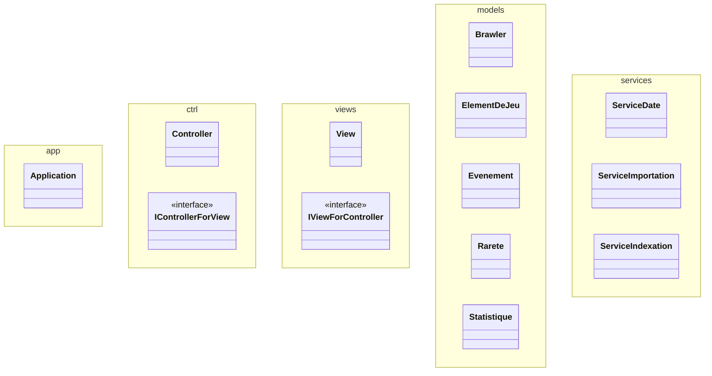
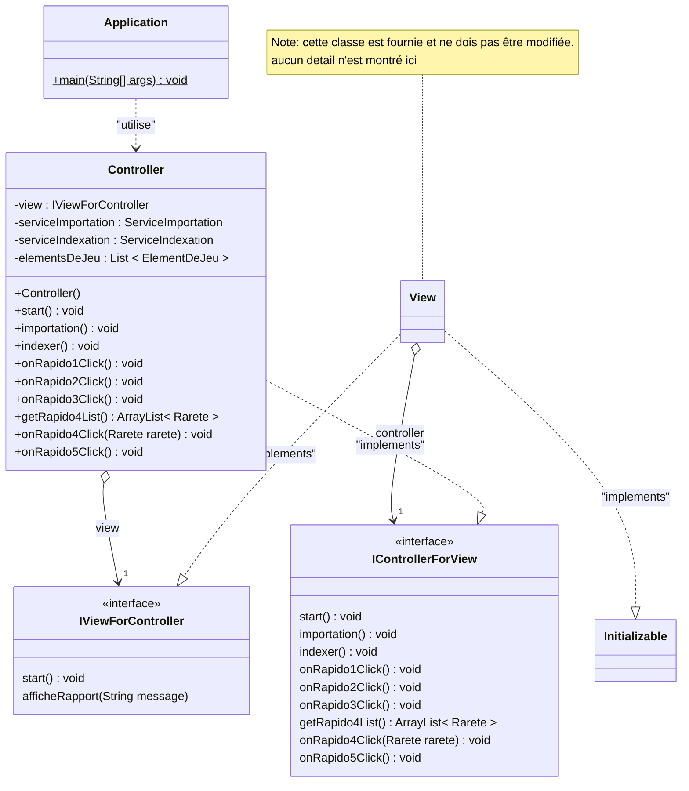
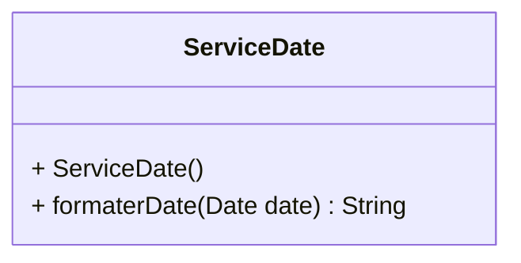
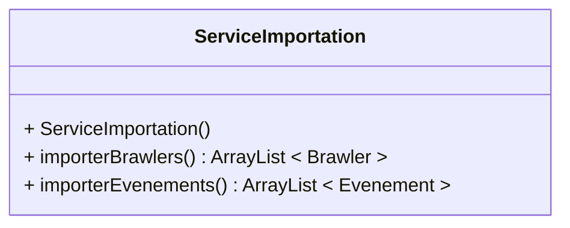
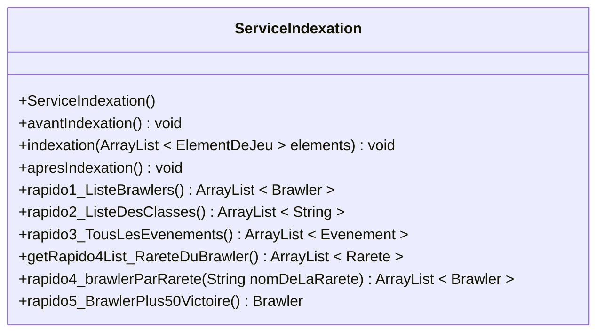
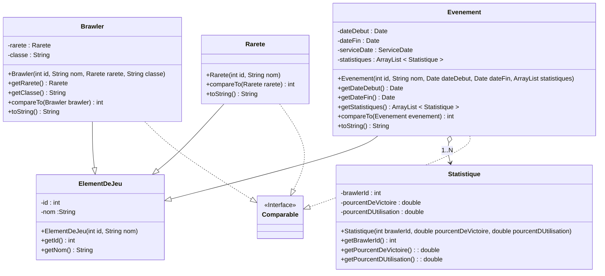

# Évaluation E1 BrawlStar

## Objectifs

 Dans le cadre d'une application réaliste en Java, vous prouvez votre maîtrise des différents sujets du module 320.

 Objectifs spécifiques:

- Comprendre l'utilité et les fonctionnalités de l'application présentée
- Comprendre et respecter l'architecture MVC
- Implémenter avec l'utilisation des principes POO (interface, héritage, ...)
- Compléter le code manquant par la lecture des schémas UML et de la javadoc fournis.
- Résoudre des problématiques de tri et d'indexation grâce aux structures de données dynamiques.
- Documenter certaines parties du code avec la javadoc
- Tester l'application avec des tests unitaires

## Durée

- **210'** (La demi-journée) 

## Fonctionnalités de l'application

L'application "BrawlStar Database" est une application demandée par un groupe de joueurs passionnés pour améliorer leur utilisation des différents brawler dans le jeu mobile BrawlStar.

Le jeu BrawlStar est un jeu mobile joueur contre joueur ou équipe contre équipe dans lequel le joueur incarne un "Brawler" (Personnage dans le jeu) pour combattre les autres personnages. Des événements sont aussi organisés dans le jeu et des statistique par événements pour chaque brawler sont tenu, tel que le taux de victoire du brawler et le taux d'utilisation de ce brawler.


Pour commencer à utiliser l'application, il faut cliquer sur le bouton "Importer" qui permettra à l'application de lire les fichiers JSON contenant les différentes informations du jeu. Cette action active le bouton "Indexer".

Quand l'utilisateur clique sur le bouton indexer, les données sont traitée pour être préparée à répondre rapidement aux 5 questions liées au différents boutons sur la zone de droite. C'est aussi à ce moment que la liste déroulante du "rapido4" est remplie avec toutes les rareté des brawlers.

### 1) Lister tous les brawlers
Doit produire la liste de tous les brawlers qui ont été importé dans l'application. Cette liste est triée par rareté (id de la rareté) puis par le nom du brawler

### 2) Lister toutes les classes
Chaque brawler est défini par une classes. Il faut lister toutes les classes présentes sans doublons par ordre alphabétique.

### 3) Lister tous les events
Des évènements sont aussi importé dans l'application. Il faut les lister dans l'ordre chronologique de la date de départ de l'évènement.

### 4) Lister les brawler en fonction de la rareté
Il faut produire la liste des brawlers, mais uniquement de la rareté sélectionnée dans la liste déroulante, dans l'ordre alphabétique.

### 5) Brawler ayant le plus souvent +50% de victoire
Pour chaque évènements, des statistiques sont faite disant quel pourcentage un certain brawler est utilisé et à quel pourcentage ce même brawler a eu des victoires. Il faut donner le nom du brawler ayant le plus souvent (durant le plus d'évènement) un pourcentage de victoire plus grand que 50%. Il n'y a qu'un seul brawler qui correspond a cette description.

## Organisation de votre travail

Vous devez en premier lieu bien comprendre le contexte de l'application et les fonctionnalités. 

Ensuite, à l'aide la documentation ci-dessous, du code et de la javadoc fournis, **vous identifiez qu'elle partie du code vous devez produire afin d'offrir à l'utilisateur toutes ces fonctionnalités**

Le choix de l'ordre dans lequel vous effectuerez votre travail fait partie de vos compétences. Cependant, afin vous aider nous vous fournissons une proposition chronologique du travail à effectuer, à la fin de ce document.

N'oubliez pas les points concernant la javadoc et les tests à la fin de ce document.

Essayez néanmoins d'obtenir rapidement une application compilable, afin de pouvoir ensuite travailler pas à pas.

Toute la partie qui concerne directement l'affichage (view.fxml et view.java) et déjà réalisée et ne doit pas être modifiée.

## Architecture du projet (packages)

Pour savoir où créer les classes du projet, voici une vue d'ensemble des packages du projet Java et leur contenu :



## Vue d'ensemble UML des classes du projet - le pattern MVC



## Détail des classes du projet


### Service des date

Vous devez compléter les méthodes du service ci-dessous à l'aide de la javadoc fournie.



Ce service est utilisé par la classe "Evenement" pour afficher la date de départ correctement.


### Service d'importation

Ce service est fourni et vous n'avez aucune modification à y apporter.



### Service d'indexation

Vous devez compléter les méthodes du service ci-dessous à l'aide de la javadoc fournie.




### Les models

Voici le diagramme des classes des différentes classes présentent dans le package models.
Pour ce qui est de l'implémentation des différentes méthodes, veuillez vous référer à la JavaDoc.




### Détail de la classe `Application`

Voici les indications manquantes qui vous permettront de terminer l'implémentation de cette classe :

#### Méthode `main()`

```mermaid
sequenceDiagram
    create participant Controller
    main()->>Controller: <<creation>>
    main()->>+Controller: start()
    Controller-->>-main(): 
```

### Détail de la classe `Controller`

#### Méthode `start()`

```mermaid
sequenceDiagram
    start()->>+view: start()
    view-->>-start(): 

```

#### Méthode `importation()`

```mermaid
sequenceDiagram
    importation()->>+ElementDeJeu:clear()
    ElementDeJeu-->-importation():void
    importation()->>+ServiceImportation:importerBrawlers()
    ServiceImportation-->>-importation():brawlers
    importation()->>+ElementDeJeu:addAll(brawlers)
    importation()->>+ServiceImportation:importerEvenements()
    ServiceImportation-->>-importation():evenements
    importation()->>+ElementDeJeu:addAll(evenements)

```

#### Méthode `indexer()`
```mermaid
sequenceDiagram
    indexer()->>+ServiceIndexation:avantIndexation()
    ServiceIndexation-->>-indexer(): 

    indexer()->>+ServiceIndexation:indexation(elementsDeJeu)
    ServiceIndexation-->>-indexer(): 

    indexer()->>+ServiceIndexation:apresIndexation()
    ServiceIndexation-->>-indexer(): 
```

#### Méthode `onRapido1Click()`
```mermaid
sequenceDiagram
    onRapido1Click()->>+ServiceIndexation:rapido1_ListeBrawlers()
    ServiceIndexation-->>-onRapido1Click(): brawlers

    onRapido1Click()->>onRapido1Click():String rapport = "";

    loop brawler in brawlers
        onRapido1Click()->>onRapido1Click():rapport += brawler + "\n"
    end

    onRapido1Click()->>+View:afficheRapport(rapport)
```

#### Méthode `onRapido2Click()`
```mermaid
sequenceDiagram
    onRapido2Click()->>+ServiceIndexation:rapido2_ListeDesClasses()
    ServiceIndexation-->>-onRapido2Click(): classes

    onRapido2Click()->>onRapido2Click():String rapport = "";

    loop classe in classes
        onRapido2Click()->>onRapido2Click():rapport += classe + "\n"
    end

    onRapido2Click()->>+View:afficheRapport(rapport)
```

#### Méthode `onRapido3Click()`
```mermaid
sequenceDiagram
    onRapido3Click()->>+ServiceIndexation:rapido3_TousLesEvenements()
    ServiceIndexation-->>-onRapido3Click(): evenements

    onRapido3Click()->>onRapido3Click():String rapport = "";

    loop evenement in evenements
        onRapido3Click()->>onRapido3Click():rapport += evenement + "\n"
    end

    onRapido3Click()->>+View:afficheRapport(rapport)
```

#### Méthode `getRapido4List()`
```mermaid
sequenceDiagram
    getRapido4List()->>+ServiceIndexation:getRapido4List_RareteDuBrawler()
    ServiceIndexation-->>-getRapido4List(): raretes

```

#### Méthode `onRapido4Click(Rarete rarete)`


#### Méthode `getRapido5List()`
```mermaid
sequenceDiagram
    getRapido5List()->>+ServiceIndexation:rapido5_BrawlerPlus50Victoire()
    ServiceIndexation-->>-getRapido5List(): brawler
    getRapido5List()->>+View:afficheRapport(brawler)

```

## Javadoc

Le service `ServiceDate` possède une méthode `formatageDeLaDate` en plus de son constructeur.

Vous devez transformer le cahier des charge ci-dessous en Javadoc.

Voici le cahier des charge de cette méthode: 

Le constructeur doit initialiser les attributs de la classe.

Le formatage de la date doit être fait comme ceci:
Le jour et le mois séparé par un "/" et sur 2 caractères. L'année qui est sur 4 caractères est aussi séparé du jour et du mois par un "/". Il faut mettre les heures et les minutes sur 2 caractères et ils sont séparé par ":". L'heure et la date sont entre parenthèse.

La méthode `formatageDeLaDate` doit recevoir une `Date` en paramètres. Si celui-ci est null alors la méthode doit retourner une string vide sinon elle retourne la date formatée.

- Vous re-générez ensuite la javadoc pour le projet complet.

## Tests unitaires

  -  Sur la base de votre Javadoc écrite selon le paragraphe précédent, vous codez la méthode  `formatageDeLaDate`.

   - Ensuite vous mettez en place un test unitaire, avec tous les pas de test nécessaires selon la théorie vue durant le module.
   - Vous exécutez ensuite ces tests unitaires et corrigez si besoin votre code en fonction des résultats des tests.
  


 

# Proposition chronologique des tâches à effectuer

Ceci est une proposition parmi d'autres solutions possibles.

-	Classe Application pour faire le main()
-	Service de formatage des dates
-	Classes ObservationBase et Observation
-	Classes Espece et EspeceDetail
-	Service de chargement des espèces
-	Service de tri des espèces
-	Classe Controller
-	Service de journal des observations
-	Service d'indexation des especes
-	Service d'indexation des observations
-	Javadoc
-	Tests unitaires


# Critères d'évaluation

| Note | Explications |
| :----: | :---- |
| **1** | **`Pas rendu / tricherie`** |
| **2** | **`Loin d'être suffisant`**<br>Le travail rendu mets en évidence de **nombreuses et profondes lacunes**. |
| **3** | **`Insuffisant`**<br>Le travail rendu mets en évidence des **difficultés/lacunes qu'il faut encore résoudre** pour atteindre le minimum syndical. |
| **4** | **`Suffisant`**<br>Le travail rendu démontre que le **minimum requis est atteint** (compréhension et capacité de mettre en oeuvre correctement).<br>Le travail rendu démontre également qu'il subsiste un **manque d'aisance** et que **plusieurs petites et moins petites erreurs ont été commises**. |
| **5** | **`Bien`**<br>Le **travail rendu est bon** tant au niveau compréhension que capacité de mettre en oeuvre correctement.<br>**Trop de petites et moins petites erreurs ont cependant été commises**. |
| **6** | **`Très bien`**<br>Le **travail rendu est excellent** et de grande qualité tant au niveau compréhension que capacité de mettre en oeuvre correctement.<br>**BRAVO !!!** |